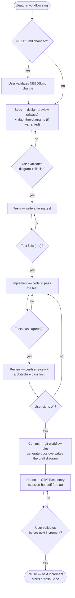

# dotfiles-claude

Personal Claude Code plugin marketplace. Syncs custom skills and agents across machines via git.

## What's in here

```
dotfiles-claude/
├── .claude-plugin/
│   └── marketplace.json        # Declares this repo as a marketplace and lists plugins
└── plugins/
    └── my-tools/
        ├── .claude-plugin/
        │   └── plugin.json     # Plugin metadata (name, version, description)
        ├── skills/             # Skill files (.md) — custom /slash commands
        └── agents/             # Agent definitions — custom Claude agent types
```

### marketplace.json

Tells Claude Code that this repo is a plugin marketplace and where to find each plugin. Points to `./plugins/my-tools` as the source for the `my-tools` plugin.

### plugin.json

Metadata for the `my-tools` plugin: name, version, description, and lists of skills/agents it exposes.

### skills/

Each `.md` file is a skill — a custom slash command Claude can run (e.g. `/my-skill`). Drop a new file here to add a skill.

### agents/

Each file defines a custom agent type available in Claude Code sessions. Drop a new file here to add an agent.

### commands/

Each `<name>.md` file is a deterministic slash command (`/name`), invoked by exact
name rather than fuzzy description matching. Currently: `/feature-workflow`.

---

## Feature Workflow

`/feature-workflow` (see `plugins/my-tools/commands/feature-workflow.md` and the
`feature-workflow`, `design-preview` skills) runs a spec-driven, gated,
cross-session cycle for building one increment at a time:



Every gate can be explicitly overridden ("skip to commit") instead of satisfied —
the override itself gets logged in `STATE.md` as `OVERRIDDEN BY USER` so a skip is
visible in history, never silent.

---

## Setup (first time on a new machine)

```bash
# 1. Register this repo as a marketplace
/plugin marketplace add https://github.com/YOUR_USERNAME/dotfiles-claude

# 2. Install the plugin
/plugin install my-tools
```

## Picking up changes after a push

```bash
/plugin marketplace update
```

## Adding a skill or agent

1. Drop a file in `plugins/my-tools/skills/` or `plugins/my-tools/agents/`
2. Update the `skills` or `agents` array in `plugins/my-tools/.claude-plugin/plugin.json`
3. Commit and push
4. On other machines: `/plugin marketplace update`
