# dotfiles-claude

Personal Claude Code plugin marketplace. Syncs custom skills and agents across machines via git.

> Click any ▶ entry below to expand its details.

## What's in here

```
dotfiles-claude/
├── .claude-plugin/
│   └── marketplace.json        # Declares this repo as a marketplace and lists plugins
└── plugins/
    └── my-tools/
        ├── .claude-plugin/
        │   └── plugin.json     # Plugin metadata (name, description, author)
        ├── skills/             # Skill directories — each a SKILL.md, auto-triggered by description match
        ├── commands/           # Deterministic slash commands — each a <name>.md
        └── agents/             # Agent definitions — custom Claude agent types
```

<details>
<summary><b>marketplace.json</b> — declares this repo as a marketplace</summary>

Tells Claude Code that this repo is a plugin marketplace and where to find each plugin. Points to `./plugins/my-tools` as the source for the `my-tools` plugin.

</details>

<details>
<summary><b>plugin.json</b> — metadata for the <code>my-tools</code> plugin</summary>

Metadata for the `my-tools` plugin: name, description, author. `skills/`, `commands/`,
and `agents/` are picked up by directory convention — nothing here enumerates them.

</details>

<details>
<summary><b>skills/</b> — auto-triggered by description match</summary>

Each skill is a directory containing a `SKILL.md` (e.g. `skills/my-skill/SKILL.md`).
Claude auto-triggers a skill when its frontmatter `description` matches the current
context — there's no explicit invocation by name required. Drop a new directory here
to add a skill.

</details>

<details>
<summary><b>agents/</b> — custom agent types</summary>

Each file defines a custom agent type available in Claude Code sessions. Drop a new file here to add an agent.

</details>

<details>
<summary><b>commands/</b> — deterministic slash commands</summary>

Each `<name>.md` file is a deterministic slash command (`/name`), invoked by exact
name rather than fuzzy description matching. Currently: `/feature-workflow`.

</details>

---

## Features

<details>
<summary><b>Feature Workflow</b> — spec-driven, gated cycle for one increment at a time</summary>

`/feature-workflow` (see `plugins/my-tools/commands/feature-workflow.md` and the
`feature-workflow`, `design-preview` skills) runs a spec-driven, gated,
cross-session cycle for building one increment at a time:

```mermaid
flowchart TD
    Start(["/feature-workflow slug"]) --> NeedsCheck{"NEEDS.md to create
or amend?"}
    NeedsCheck -- yes --> Grill["grilling — until shared understanding"]
    Grill --> ValidateNeeds["User validates NEEDS.md change"]
    ValidateNeeds --> Spec
    NeedsCheck -- no --> Spec["Spec — design-preview (always)
+ algorithm-diagrams (if warranted)"]
    Spec --> GateSpec{"User validates
diagram + file list?"}
    GateSpec -- no --> Spec
    GateSpec -- yes --> Seams["Build — agree test seams with user
(bug fix: diagnosing-bugs builds the repro first)"]
    Seams --> Red["Write one failing test at the next seam"]
    Red --> Green["Write minimal code to pass it"]
    Green --> GateBuild{"Every agreed seam
has a passing test?"}
    GateBuild -- no --> Red
    GateBuild -- yes --> Review["Review — per-file-review + architecture
+ code-review (NEEDS.md as spec); refactor here"]
    Review --> GateReview{"User signs off?"}
    GateReview -- no --> Review
    GateReview -- yes --> Commit["Commit — git-workflow rules;
generate-docs overwrites the draft diagram"]
    Commit --> Report["Report — STATE.md entry
(session-handoff format)"]
    Report --> GateReport{"User validates
before next increment?"}
    GateReport -- no --> Report
    GateReport -- yes --> CloseCommit["Close — commit STATE.md (+ NEEDS.md)
as the increment's last commit; push if Commit pushed"]
    CloseCommit --> Pause(["Pause — next increment
starts a fresh Spec"])
```



Every gate can be explicitly overridden ("skip to commit") instead of satisfied —
the override itself gets logged in `STATE.md` as `OVERRIDDEN BY USER` so a skip is
visible in history, never silent.

</details>

---

## Skills

All live in `plugins/my-tools/skills/<name>/SKILL.md`.

<details>
<summary><b>Management skills</b></summary>

<details>
<summary><code>feature-workflow</code></summary>

**Problem:** Without a fixed process, work drifts: features stay half-done, steps get skipped, and the AI runs ahead without input. The human is responsible for the AI's work, so they need checkpoints.

**Solution:** We fix the order of phases (Spec → Build → Review → Commit → Report) and build in small increments. Each phase needs explicit human validation before the next one starts. A skip is possible but always logged. Progress is saved to disk, so work resumes across sessions.

</details>

<details>
<summary><code>git-workflow</code></summary>

**Problem:** Git history can be undescriptive, confusing, or worse, misleading. Advanced git commands are also easy to get wrong, and some are hard to undo.

**Solution:** Commits are small, focused, and use Conventional Commits with a body stating what changed and why. Broad changes get their own branch. For advanced git, the AI explains the command first, prefers the reversible option, and asks before anything destructive.

</details>

<details>
<summary><code>session-handoff</code></summary>

**Problem:** A long session gathers important information about the work done and/or being done, but may lead to tunnel vision. Restarting a session tempers the tunnel vision but loses context.

**Solution:** We summarize the session for the next one: what changed and why, decisions with their rationale, open issues, ordered next steps, and suggested `CLAUDE.md` additions for the user to approve.

</details>

<details>
<summary><code>loop-guard</code></summary>

**Problem:** An AI often gets stuck on one idea, retrying the same failing approach with small variations instead of stepping back.

**Solution:** When the same approach or error comes back twice, the AI stops and asks the user to choose: a fresh session, or a clearly different approach.

</details>

</details>

<details>
<summary><b>Technical skills</b></summary>

<details>
<summary><code>coding</code></summary>

**Problem:** Code that works can still be hard to understand and hard to change.

**Solution:** This is the entry point to the coding standards. It points the AI to the focused skills below. The AI writes clean code from the start instead of "cleaning up later", refactors in small safe steps, and explains any non-obvious trade-off it made.

</details>

<details>
<summary><code>architecture</code></summary>

**Problem:** A codebase must stay extensible, testable, understandable and modifiable as it grows.

**Solution:** We apply principles that hold in any project: one responsibility per module, DRY, dependency inversion and the rest of SOLID. YAGNI balances them: no abstraction until a second real case exists.

</details>

<details>
<summary><code>function-design</code></summary>

**Problem:** A function that does several things is harder to understand, its name can't describe everything it does, and its parts can't be reused.

**Solution:** Functions stay small and do one thing, so code reads like a step-by-step procedure. Deep nesting is extracted into named functions, and loop exit conditions are visible.

</details>

<details>
<summary><code>naming-conventions</code></summary>

**Problem:** Misleading, confusing or imprecise names make code hard to understand and modify.

**Solution:** Names are specific, verbose if needed, never abbreviated. Magic numbers become named constants. Comments explain why, not what. A primitive that carries meaning (a price in cents) gets its own type.

</details>

<details>
<summary><code>error-handling</code></summary>

**Problem:** Swallowed errors hide bugs instead of exposing them, and unchecked external input lets bad or malicious data deep into the system.

**Solution:** We fail loudly and early with a specific error, never a silent `None`. External input is validated once, where it enters the system, and trusted after that.

</details>

<details>
<summary><code>type-safety</code></summary>

**Problem:** When types are vague, an object can be used as something it isn't. The resulting error shows up late, at runtime.

**Solution:** Public signatures are typed. Structured data gets a named type instead of `dict`, `Object` or `Any`. A return value never uses `None` for two different meanings. We know what we expect, or we don't know what we're doing. Types serve clarity, though, and aren't added for their own sake.

</details>

<details>
<summary><code>testing</code></summary>

**Problem:** Without tests, important code becomes scary to change, so we stop changing it and it rots.

**Solution:** Matt Pocock's `tdd` is the base: a failing test first, tests that check behavior rather than internals, mocks only at external boundaries. This skill adds what `tdd` doesn't cover: Arrange-Act-Assert, failure-path coverage, and tests that run independently.

</details>

<details>
<summary><code>python-conventions</code></summary>

**Problem:** Python has gotchas we shouldn't repeat.

**Solution:** We record them: add a `__main__` guard only when a file is both a script and imported, and force UTF-8 console output on Windows (the default is cp1252).

</details>

<details>
<summary><code>per-file-review</code></summary>

**Problem:** A code review may miss issues due to large context.

**Solution:** One subagent reviews each changed file, with its whole context spent on that file. It checks only file-local rules. Architecture and correctness stay separate whole-repo reviews. Findings are shown before any fix is applied.

</details>

</details>

<details>
<summary><b>Documentation skills</b></summary>

<details>
<summary><code>design-preview</code></summary>

**Problem:** A human must be responsible for and validate the AI's work. However, it can become a grey box with the AI doing most of the work for us.

**Solution:** Before writing code, the AI draws the proposed classes inside their existing neighborhood (extending a copy of an existing diagram when one exists), highlights what's new, and lists the files it will touch. A human validates it explicitly before any code is written.

</details>

<details>
<summary><code>algorithm-diagrams</code></summary>

**Problem:** Algorithms can be hard to follow from code.

**Solution:** For unusual or business-critical algorithms only, the AI draws an activity diagram before writing the code, tells the user, and updates the diagram if the code diverges from it.

</details>

<details>
<summary><code>generate-docs</code></summary>

**Problem:** Keeping documentation up to date is often seen as a chore and forgotten. This leads to unreliable information, and bad context for the AI. The AI easily makes mistakes when writing a lot of documentation all at once.

**Solution:** A script generates what can be extracted directly from code, instead of the AI writing it. feature-workflow runs it at every increment. When no script supports the language, the AI says so and falls back to hand-drawn diagrams.

</details>

<details>
<summary><code>decision-log</code></summary>

**Problem:** Over the course of a project, decisions are made for reasons. Remembering those reasons, knowing why something was done a certain way and not another, can be difficult later on in a project.

**Solution:** Decisions go into an ADR in `docs/adr/` (format from Matt Pocock's `domain-modeling`), and the code keeps only a short pointer. Before relying on an old ADR, the AI checks that it still matches the code. An outdated ADR is superseded by a new one, never edited.

</details>

</details>

<details>
<summary><b>Matt Pocock's skills (upstream)</b></summary>

From [mattpocock/skills](https://github.com/mattpocock/skills), installed as the
`mattpocock-skills` plugin and never copied here. Where one overlaps a `my-tools`
skill, his wins ([ADR 0001](docs/adr/0001-use-mattpocock-skills-from-upstream.md)).

<details>
<summary><code>tdd</code></summary>

**Problem:** Tests written all at once, before or after the code, end up testing an imagined design, or simply repeat what the code already does. Tests coupled to internals break on every refactor.

**Solution:** The AI agrees with the user which seams (public boundaries) to test, then works one seam at a time: one failing test, then the minimal code to pass it. Tests go through public interfaces, mock only system boundaries, and never recompute the expected value the way the code does. Refactoring waits for review. `testing` adds Arrange-Act-Assert, failure paths and independent tests on top.

</details>

<details>
<summary><code>codebase-design</code></summary>

**Problem:** Modules with a large interface and little behind it ("shallow" modules) push complexity onto every caller and are hard to test. Without shared words for this, design discussions stay vague.

**Solution:** A shared vocabulary (module, interface, seam, adapter, depth) and the goal of deep modules: a lot of behavior behind a small interface, tested through that interface. A seam is only introduced when something actually varies across it. `architecture` uses this vocabulary for module interfaces.

</details>

<details>
<summary><code>domain-modeling</code></summary>

**Problem:** Terms drift (one word, two meanings), and the reasons behind hard-to-reverse decisions get lost or scattered.

**Solution:** Resolved terms go into `GLOSSARY.md` as they're settled. Decisions that are hard to reverse, surprising without context, and the result of a real trade-off become short ADRs in `docs/adr/`. `decision-log` uses its ADR format for every decision record.

</details>

<details>
<summary><code>code-review</code></summary>

**Problem:** A review that only checks style misses whether the change does what was asked, and one reviewer juggling both checks does each worse.

**Solution:** Two parallel sub-agents review the diff since a fixed point: one against the repo's documented standards plus a baseline of code smells, one against the spec. In feature-workflow's Review phase, the spec is the feature's `NEEDS.md`, and it runs alongside `per-file-review` and `architecture`.

</details>

<details>
<summary><code>grilling</code></summary>

**Problem:** A plan or need that sounds clear often hides unstated assumptions, which surface only once the work is built wrong.

**Solution:** The AI interviews the user in rounds: each round asks every question whose prerequisites are settled, with a recommended answer, until no branch of the decision tree is left open. It looks up facts itself instead of asking. feature-workflow runs it before any `NEEDS.md` change is validated.

</details>

<details>
<summary><code>diagnosing-bugs</code></summary>

**Problem:** Debugging by reading code and guessing leads to fixes for the wrong cause, and bugs that come back.

**Solution:** Before any theory, the AI builds a tight feedback loop: one fast, deterministic command that goes red on this exact bug. It then reproduces and minimizes the bug, tests hypotheses against the loop, and fixes it. In feature-workflow's Build phase, that red loop is the first failing test.

</details>

<details>
<summary><code>writing-for-agents</code></summary>

**Problem:** Skills and `CLAUDE.md` files are read by an agent, not a person. Vague trigger wording, duplicated rules and long files make the agent behave differently from run to run.

**Solution:** Rules for writing agent documents: precise trigger wording, each rule in one place, rarely needed detail moved behind pointers, steps with a clear "done" condition, positive phrasing over prohibitions, and regular pruning. Used whenever a `my-tools` skill is edited.

</details>

</details>

---

## Setup (first time on a new machine)

```bash
# 1. Register this repo as a marketplace
/plugin marketplace add https://github.com/YOUR_USERNAME/dotfiles-claude

# 2. Install the plugin
/plugin install my-tools

# 3. Register Matt Pocock's marketplace and install his skills
/plugin marketplace add mattpocock/skills
/plugin install mattpocock-skills@mattpocock
```

Then, once in each project where feature-workflow's Review phase should use his
`code-review`, run `/setup-matt-pocock-skills`.

## Picking up changes after a push

```bash
/plugin marketplace update
```

## Adding a skill, command, or agent

1. Drop a `skills/<name>/SKILL.md`, `commands/<name>.md`, or `agents/<name>.md` file
   under `plugins/my-tools/`. No manifest to update — all three are auto-discovered
   by directory convention.
2. Commit and push
3. On other machines: `/plugin marketplace update`
