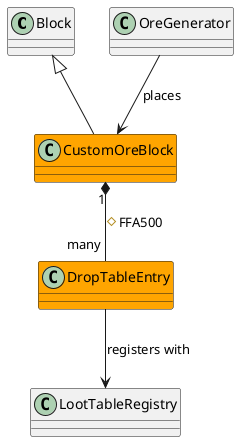

# Design Preview — Propose Structure, Get Sign-Off, Before Any Code

## 1. Always Draft — No Skip-If-Trivial Judgment Call

Unlike `algorithm-diagrams` (which only fires for unusual/important algorithms and
explicitly skips trivial cases), this skill fires every time new or changed structure
is about to be introduced. The point is a reliable human checkpoint on architecture
every time, not just when something looks important — "looks important" is exactly
the kind of judgment that misses things.

## 2. Highlight What's New — Inside Its Existing Neighborhood

Draw the proposed class diagram in standard PlantUML. Give every new or changed class,
interface, and relationship a consistent, obvious highlight color — distinct from
default styling — so the reviewer can spot additions at a glance instead of diffing
the diagram by hand against what already exists.

**Showing only the new classes is not enough to validate.** The point of the sign-off
isn't "does this new class look fine on its own" — it's "does this fit correctly into
the architecture that already exists." That judgment needs the new/changed classes'
immediate neighborhood: every existing class that calls into them, and every existing
class they call into or depend on (one hop out in each direction is the default —
go further only if a reviewer would need it to judge a specific relationship).
Include those existing classes in the same diagram, in default/unhighlighted styling,
with the real relationships drawn to them — not just a caption saying they exist.

Here `OreGenerator` (calls into the new class) and `LootTableRegistry` (called into by
the new class) are existing code, drawn unhighlighted, so the reviewer can see the new
piece wired into its real neighbors — not floating alone with no indication of how it's
actually reached or what it actually touches.

`#FFA500` (orange) is the default highlight; keep whatever color is chosen consistent
across one project so the reviewer learns it once. Existing, unchanged classes stay
default/no color — highlighted only if they themselves are modified (e.g. a new method
added to an existing class to call the new one).

## 3. List the Files

Alongside the diagram, name the concrete files that will be created or modified to
realize this design. The diagram shows the shape; the file list shows the blast
radius — the reviewer needs both to validate the proposal.

## 4. Where to Save

Use the same detection logic as `algorithm-diagrams`: look for where diagrams already
live in the project (`doc/`, `docs/`, `Modelisation/`, or the project's own
convention) and save there. Ask the user if no existing convention is found — don't
guess a new one. Saving at the same path matters: `generate-docs` will later overwrite
this exact file once the design is implemented (see rule 6).

## 5. Gate — Do Not Proceed Without Explicit Validation

Do not move on to writing tests or implementation code until the user has explicitly
validated the diagram and file list. "Looks fine" from a quick skim doesn't count as
validation if the user hasn't actually looked — if there's any doubt they've reviewed
it, ask directly rather than assuming silence means approval.

## 6. This Draft Is Temporary

The highlighted diagram is a proposal for review, not documentation of truth. Once the
design is implemented and committed, `generate-docs` regenerates the diagram from the
real source at the same file path, overwriting this hand-drawn draft with the as-built
version — plain styling, no highlight, because it now reflects what actually exists
rather than what was proposed. Don't present this draft as if it were permanent
documentation; say explicitly that it will be superseded once the code lands.

## 7. Relationship to `algorithm-diagrams`

Separate, unchanged skill: `algorithm-diagrams` owns activity/control-flow diagrams
for unusual or important algorithms, conditionally. This skill owns structural class
diagrams, unconditionally. Both can fire for the same piece of work — a new class with
an unusual algorithm inside one of its methods gets a class diagram from this skill
and an activity diagram from `algorithm-diagrams`.
